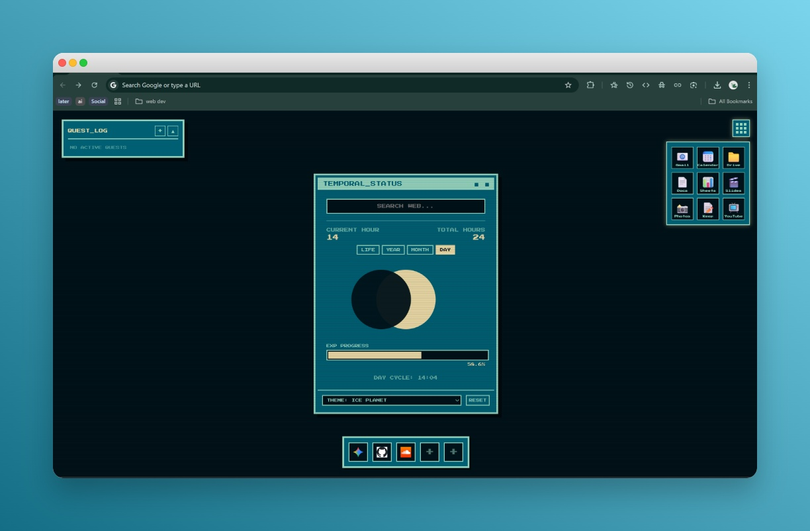

# Retro Life: Progress & New Tab

Rethink your new tab page. **Retro Life** transforms your browser into a retro-futuristic dashboard that helps you visualize your life's progress, manage daily quests, and stay focused—all with a stunning pixel-art aesthetic.




## 🌟 Features

### ⏳ Temporal Status (Life Progress)
Visualize your journey through time with RPG-style experience bars and a **dynamic Solar Eclipse**. Switch between separate cycles to see your progress:
*   **🌑 Solar Eclipse Visualization**: The central visual element where the shadow moves across the sun, representing the percentage of time passed in your current cycle (Day, Month, Year, or Life). As time runs out, the eclipse completes.
*   **LIFE**: Your overall life progress.
*   **YEAR**: How much of the current year has passed.
*   **MONTH**: Progress through the current month.
*   **DAY**: Track the day from current time to midnight.

### 📜 Quest Log (Task Manager)
Gamify your daily tasks. The **Quest Log** allows you to:
*   Add daily "Quests" (tasks).
*   Mark quests as completed.
*   Clear completed quests to keep your log clean.
*   Minimalist interface that creates a satisfying "quest completion" feel.

### 🎒 Inventory Dock (Shortcuts)
Keep your most important links in your **Inventory**. Add shortcuts to your favorite websites for quick access, visualized as inventory slots.

### 🎨 Retro Themes
Customize your dashboard with a variety of iconic retro themes:
*   🌌 **Cosmic** (Default)
*   🕹️ **Gameboy** (Classic Green)
*   🌆 **Vaporwave** (Neon Pink/Cyan)
*   🚨 **Red Alert** (Tactical Red)
*   🔸 **Amber** (Vintage Terminal)
*   💻 **Matrix** (Hacker Green)
*   🗺️ **Sepia Map** (Old Paper)
*   ❄️ **Ice Planet** (Cool Blue)
*   🌸 **Lavender** (Soft Purple)
*   ⚫ **1-Bit** (High Contrast Black & White)

### 🧩 Other Tools
*   **Google Apps Tray**: Quick access to common Google services (Gmail, Drive, Calendar, etc.).
*   **Web Search**: Minimalist search bar to jump straight to the web.

## 🚀 Installation

### Chrome Web Store
[**Download Retro Life on the Chrome Web Store**](https://chromewebstore.google.com/detail/hnmomhmpnkijiddpokloiihjffnfajin?utm_source=item-share-cb)

### Manual Installation (Developer Mode)
If you want to run the developer version or contribute:
1.  Clone this repository:
    ```bash
    git clone https://github.com/niteshrajpurohitt/retro-life-new-tab.git
    ```
2.  Open Chrome and navigate to `chrome://extensions/`.
3.  Toggle **Developer mode** in the top right corner.
4.  Click **Load unpacked**.
5.  Select the folder where you cloned this repository.

## 🛠️ Usage
1.  **Onboarding**: The first time you open a new tab, you'll be asked to input your birth date. This is required to calculate your "Life Level" and experience points.
2.  **Settings**: Click the theme dropdown at the bottom to change the visual style.
3.  **Reset**: Need to change your birth date or clear data? Click the **RESET** button in the footer.

## 🔒 Privacy
**Retro Life** respects your privacy.
*   All data (birth date, quests, shortcuts) is stored **locally** on your device using Chrome's Local Storage API.
*   No personal data is sent to external servers.
*   The extension functions entirely offline.

## 🤝 Contributing
Contributions are welcome! If you have ideas for new themes or features:
1.  Fork the repository.
2.  Create a feature branch
3.  Commit your changes.
4.  Push to the branch.
5.  Open a Pull Request.

## 📄 License
This project is open source and available under the [MIT License](LICENSE).
